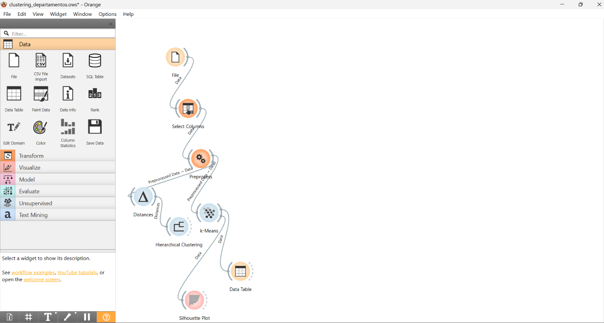
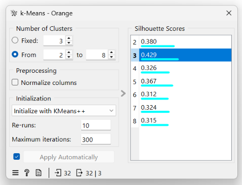
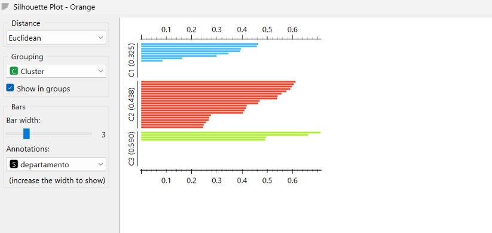
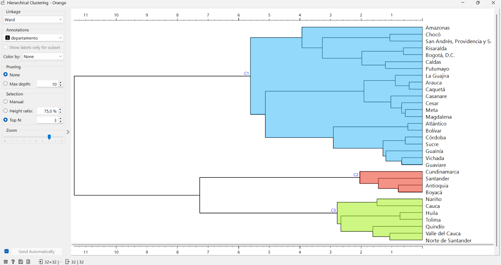
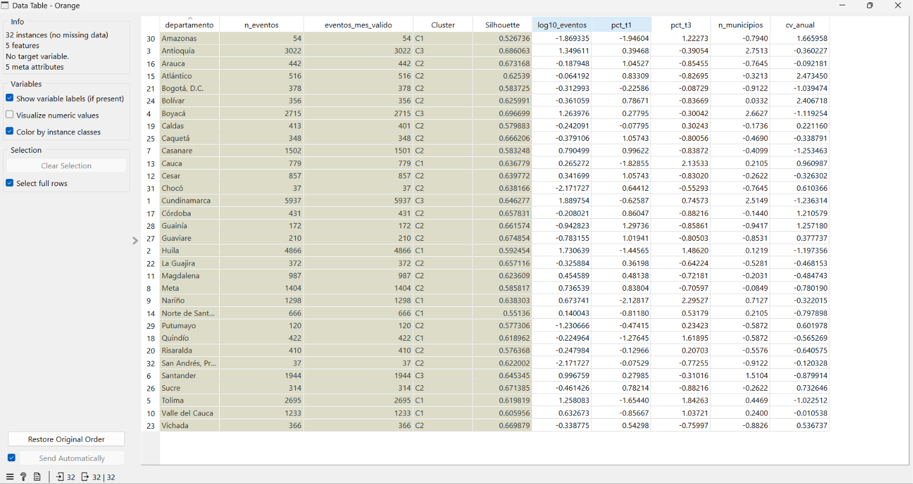

# Sección 2. Clustering de departamentos

## 1. Pregunta y objetivo

**Pregunta:** ¿qué grupos de departamentos comparten un mismo perfil de incendios de la cobertura vegetal en cuanto a intensidad, estacionalidad, extensión territorial y regularidad entre años?

**Objetivo:** descubrir perfiles de departamentos que no se ven en los conteos ni en las matrices de las Etapas 4 y 5, describir cada grupo de forma comprensible y proponer decisiones que podrían apoyarse en él.

El ejercicio no usa el área, las hectáreas, la clase de tamaño ni la variable "grande", porque son el objetivo del ejercicio supervisado.

## 2. Datos usados y transformaciones

- **Fuente:** `data/processed/incendios_ideam_tratado_2010_2024.csv`, con 35.355 eventos (BD-ICV, IDEAM, 2010-2024).
- **Script:** `scripts/etapa6/preparar_clustering.py`.
- **Unidad de análisis:** el departamento. Cada fila resume sus eventos de 2010 a 2024.

| Paso | Filas |
|---|---|
| Eventos de entrada | 35.355 |
| Descartados sin departamento | 43 |
| Descartados con departamento pero sin año (1 de Cundinamarca, abril) | 1 |
| Eventos usados para el perfil | 35.311 |
| Departamentos | 33 |
| Excluidos por tener menos de 30 eventos con mes válido (Vaupés, 8 eventos) | 1 |
| **Departamentos para el clustering** | **32 (35.303 eventos)** |

Cundinamarca queda con 5.937 eventos en lugar de los 5.938 del conjunto completo, porque se descarta el evento sin año.

**Variables de agrupamiento:**

| Variable | Qué mide | Cálculo |
|---|---|---|
| `log10_eventos` | Intensidad | log10 del número de eventos con año. El logaritmo evita que Cundinamarca y Huila dominen la escala |
| `pct_t1` | Estacionalidad de enero a marzo | % de eventos de enero a marzo. **Denominador:** eventos con mes válido |
| `pct_t3` | Estacionalidad de julio a septiembre | % de eventos de julio a septiembre. Mismo denominador |
| `n_municipios` | Extensión territorial | Municipios distintos con al menos un evento |
| `cv_anual` | Regularidad entre años | Desviación estándar / media de los eventos por año en 2010-2024, contando los años con 0 eventos |

`n_eventos` y `eventos_mes_valido` quedan como metadatos: sirven para leer los grupos, pero no participan en las distancias.

**Exclusión de Vaupés:** con 8 eventos, un solo incendio mueve sus porcentajes en 12,5 puntos, así que su perfil no es estable. Con el umbral de 30 eventos, cada evento mueve como máximo 3,3 puntos.

**Estandarización:** las variables tienen escalas muy distintas. Por ejemplo, `n_municipios` va de 1 a 126 y `cv_anual` de 0,57 a 2,57. Sin estandarizar, la variable con números más grandes dominaría la distancia euclidiana. Por eso todas se llevan a media 0 y desviación 1.

## 3. Flujo de Orange

Archivo: `orange/clustering/clustering_departamentos.ows` (Orange 3.40.0).



*Figura 1. Flujo completo. La rama de k-Means elige el número de grupos y la rama jerárquica sirve para contrastar el resultado.*

| Widget | Conexión (de → a) | Parámetros |
|---|---|---|
| File | → Select Columns | `data/etapa6/clustering/perfil_departamentos.csv`; 32 filas |
| Select Columns | File → Preprocess | Variables: `log10_eventos`, `pct_t1`, `pct_t3`, `n_municipios`, `cv_anual`. Metas: `departamento`, `n_eventos`, `eventos_mes_valido`. Sin variable objetivo |
| Preprocess | Select Columns → k-Means, Distances | Normalize Features: estandarizar a μ = 0, σ² = 1 |
| k-Means | Preprocess → Silhouette Plot, Data Table | k de 2 a 8; inicialización k-Means++; 10 repeticiones; 300 iteraciones como máximo; "Normalize columns" desmarcado porque los datos ya llegan estandarizados |
| Silhouette Plot | k-Means → | Distancia euclidiana; agrupado por Cluster |
| Data Table | k-Means → | Muestra el grupo asignado a cada departamento |
| Distances | Preprocess → Hierarchical Clustering | Euclidiana, sin normalizar (ya estandarizado) |
| Hierarchical Clustering | Distances → | Enlace Ward; anotaciones por `departamento`; selección Top N = 3 |

## 4. Resultados

### 4.1 Elección del número de grupos



*Figura 2. Silueta promedio de k-Means para cada k. El mayor valor se obtiene con k = 3.*

| k | 2 | **3** | 4 | 5 | 6 | 7 | 8 |
|---|---|---|---|---|---|---|---|
| Silueta | 0,380 | **0,429** | 0,326 | 0,367 | 0,312 | 0,324 | 0,315 |

Se elige **k = 3**, porque tiene la silueta más alta. Con más grupos la silueta baja, es decir, los grupos adicionales se separan peor. Una silueta de 0,429 indica una estructura de grupos razonable, aunque no muy marcada.

### 4.2 Calidad de cada grupo



*Figura 3. Silueta de cada departamento. Cuanto más larga la barra, mejor encaja en su grupo. Ningún departamento tiene silueta negativa.*

| Grupo en Orange | Departamentos | Silueta del grupo |
|---|---|---|
| C3: Andinos grandes y extendidos | 4 | 0,590 |
| C2: Pico en enero-marzo | 20 | 0,438 |
| C1: Pico en julio-septiembre | 8 | 0,325 |

El grupo andino es el más compacto. El de julio-septiembre es el más difuso, y su caso más débil es Amazonas.

### 4.3 Contraste con el clustering jerárquico



*Figura 4. Dendrograma con enlace Ward, cortado en 3 grupos. La numeración de los grupos no coincide con la de k-Means; deben compararse por su contenido.*

El jerárquico obtiene los mismos 3 grupos, con 21, 4 y 7 departamentos. La única diferencia es **Amazonas**, que pasa del grupo de julio-septiembre al de enero-marzo. El índice de Rand ajustado entre ambos métodos es 0,891, calculado fuera de Orange con scikit-learn sobre los mismos datos estandarizados. Por eso los grupos son **estables frente al algoritmo**.

El dendrograma muestra además que los grupos andinos (grande y de julio-septiembre) se unen primero, cerca de 7 en la escala, y solo al final, cerca de 11,4, se unen con el grupo de enero-marzo. La separación principal está entre los departamentos con pico en enero-marzo y los andinos.

### 4.4 Caracterización de los grupos



*Figura 5. Departamentos con el grupo asignado por k-Means. Las variables aparecen estandarizadas; la tabla siguiente usa los valores originales. La columna "Silhouette" de este widget es una aproximación por centroides y no se usa en el análisis.*

Promedios con los valores originales (entre paréntesis, mínimo y máximo):

| Grupo | Departamentos | Eventos (prom.) | % ene-mar | % jul-sep | Municipios | Variación anual |
|---|---|---|---|---|---|---|
| **A. Andinos grandes y extendidos** (C3) | 4 | 3.405 (1.944-5.937) | 66 % (48-75) | 20 % (12-40) | 113 (84-126) | 0,76 (0,57-1,04) |
| **B. Pico en julio-septiembre** (C1) | 8 | 1.502 (54-4.866) | 25 % (8-43) | 59 % (35-78) | 35 (6-57) | 1,15 (0,60-2,13) |
| **C. Pico en enero-marzo, menos eventos** (C2) | 20 | 484 (37-1.502) | 79 % (52-98) | 7 % (0-29) | 16 (1-34) | 1,37 (0,57-2,57) |

**Grupo A. Andinos grandes y extendidos: Cundinamarca, Antioquia, Boyacá y Santander.**
- Reúnen 13.618 eventos, el 38,6 % de los usados, con solo 4 departamentos.
- Lo que más los distingue es el número de municipios afectados (2,4 desviaciones sobre la media) y la intensidad.
- También son los más regulares entre años.
- Sus eventos se concentran en enero-marzo, pero con un segundo pico en julio-septiembre (20 % en promedio; 40 % en Cundinamarca).
- *Descripción:* incendios frecuentes, repartidos por casi todo el territorio y presentes todos los años.

**Grupo B. Pico en julio-septiembre: Huila, Tolima, Nariño, Valle del Cauca, Cauca, Norte de Santander, Quindío y Amazonas.**
- Reúnen 12.013 eventos (34,0 %).
- Lo que los distingue es la estacionalidad invertida: pocos eventos en enero-marzo (1,5 desviaciones bajo la media) y muchos en julio-septiembre (1,5 por encima).
- *Descripción:* departamentos andinos del sur y occidente cuya temporada de incendios es la de mitad de año.
- Amazonas queda en este grupo con poca seguridad: solo tiene 54 eventos.

**Grupo C. Pico en enero-marzo, menos eventos: Casanare, Meta, Arauca, Vichada, Guaviare, Guainía, Caquetá, Putumayo, Magdalena, Cesar, Atlántico, Bolívar, Córdoba, Sucre, La Guajira, Caldas, Risaralda, Bogotá, Chocó y San Andrés.**
- Reúnen 9.672 eventos (27,4 %).
- Casi 8 de cada 10 eventos ocurren en enero-marzo, con muy pocos en julio-septiembre.
- Tienen menos eventos, afectan pocos municipios y son los más irregulares entre años.
- *Descripción:* Llanos, Caribe y Amazonía, con una sola temporada de incendios a comienzos de año y años muy distintos entre sí.

## 5. Interpretación y aporte al problema

1. **El calendario divide al país en dos.** En la Etapa 5 se vio que Orinoquia concentra sus hectáreas en enero-marzo y Andina en julio-septiembre. El clustering muestra que esa diferencia no depende de la región administrativa: separa a los departamentos andinos en dos perfiles distintos (A y B). Huila y Tolima, que son andinos, se parecen más a Nariño y Cauca que a Cundinamarca o Boyacá.
2. **La extensión territorial es un perfil propio.** El grupo A no se distingue solo por tener muchos eventos, sino porque los incendios aparecen en más de 80 municipios por departamento y todos los años. Ese perfil no aparece al ordenar por conteos.
3. **Los departamentos con menos eventos son también los menos predecibles.** El grupo C combina una temporada muy marcada con años muy distintos entre sí. Por eso los promedios de pocos años sirven poco para planear en esos departamentos.

**Decisiones que podría apoyar:**
- Programar la preparación por perfil y no solo por región: antes de enero en el grupo C y en el A; antes de julio en el grupo B y como segunda temporada en el A.
- Reforzar la coordinación entre municipios en el grupo A, donde los eventos están dispersos por casi todo el territorio.
- Mantener capacidad flexible en el grupo C, donde la cantidad de eventos cambia mucho de un año a otro.

## 6. Limitaciones e hipótesis

- **Cambios en el reporte:** los perfiles describen los eventos reportados, no todos los incendios. El reporte cambia entre hojas de origen y años, y eso puede afectar sobre todo la variación anual.
- **Departamentos con pocos eventos:** Amazonas (54), Chocó (37) y San Andrés (37) tienen porcentajes inestables. Amazonas cambia de grupo según el algoritmo.
- **Calidad de la estructura:** una silueta de 0,429 indica grupos razonables pero no muy separados. El grupo B (0,325) es el más difuso.
- **Datos de Bogotá:** sus 2 municipios reflejan cómo se registró el nombre en los datos, no una división real.
- **Variables omitidas:** se omitieron causa y cobertura porque faltan en la mayoría de los eventos, y coordenadas y elevación porque son nulas en el 97 % de los casos.
- **Evidencia frente a hipótesis:** que existan los 3 perfiles es evidencia, porque se repite con dos algoritmos. Explicar los perfiles por el régimen de lluvias (dos temporadas secas en la zona andina, una en Llanos y Caribe) es una **hipótesis**: este análisis no usa datos climáticos.

## 7. Cómo reproducirlo

```powershell
python scripts/etapa6/preparar_clustering.py
```

1. El script genera `data/etapa6/clustering/perfil_departamentos.csv` (32 departamentos) y `departamentos_excluidos.csv` (Vaupés).
2. Abre `orange/clustering/clustering_departamentos.ows` en Orange 3.40.0 o superior.
3. Orange guarda la ruta completa del CSV, porque los datos están fuera de la carpeta del flujo. En otro computador, abre el widget **File** y vuelve a elegir `data/etapa6/clustering/perfil_departamentos.csv`.
4. El widget k-Means debe mostrar la silueta 0,429 para k = 3.

## 8. Resumen para las conclusiones integradas

1. **Hay 3 perfiles de departamentos** (k = 3, silueta 0,429). Se repiten con el jerárquico Ward, con una sola diferencia (Amazonas) y un índice de Rand ajustado de 0,891.
   - *Interpretación:* los departamentos se agrupan por cuándo y dónde ocurren los incendios, no solo por cuántos tienen.
   - *Tipo:* evidencia.
2. **Grupo andino grande:** 4 departamentos (Cundinamarca, Antioquia, Boyacá y Santander) reúnen el 38,6 % de los eventos, con 113 municipios afectados en promedio y la menor variación anual (0,76).
   - *Interpretación:* el problema ahí es extendido y constante.
   - *Tipo:* evidencia.
3. **Grupo de julio-septiembre:** 8 departamentos (Huila, Tolima, Nariño, Valle del Cauca, Cauca, Norte de Santander, Quindío y Amazonas) tienen en promedio el 59 % de sus eventos en julio-septiembre.
   - *Interpretación:* la temporada no es igual en toda la zona andina, así que la preparación debe ajustarse por departamento.
   - *Tipo:* evidencia.
4. **Grupo de enero-marzo:** 20 departamentos de Llanos, Caribe y Amazonía concentran en promedio el 79 % de sus eventos en enero-marzo y tienen la mayor variación entre años (1,37).
   - *Tipo:* evidencia.
   - *Hipótesis por validar:* que la estacionalidad se deba al régimen de lluvias.
   - **Limitación:** los perfiles describen eventos reportados, y el reporte cambia entre hojas de origen y años.
