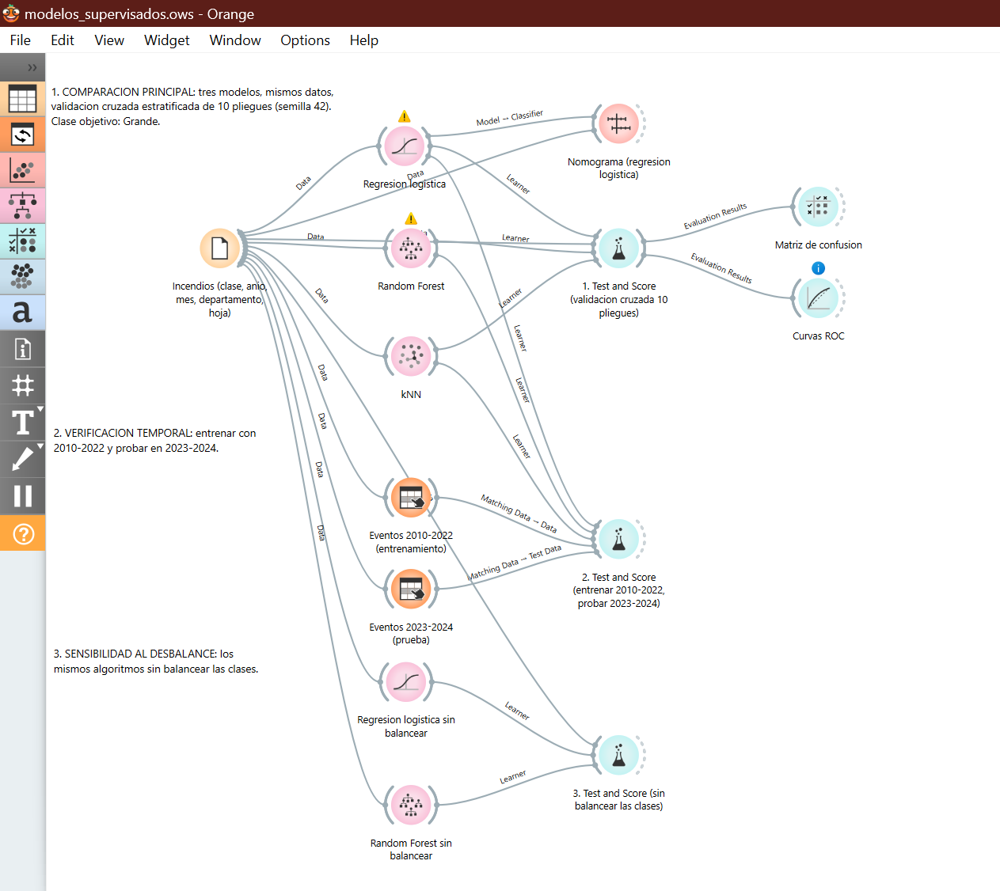
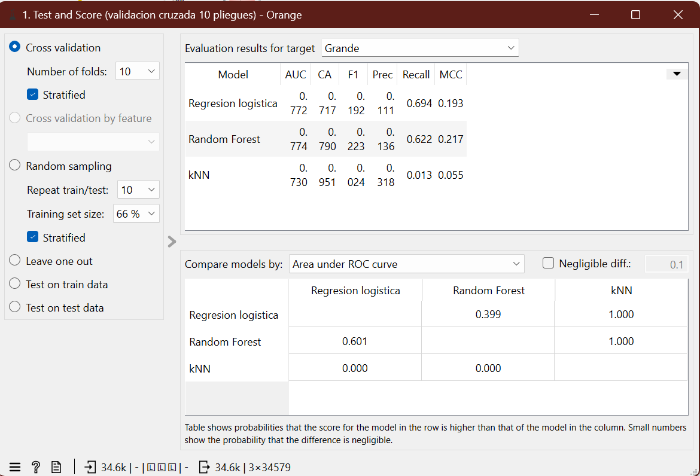
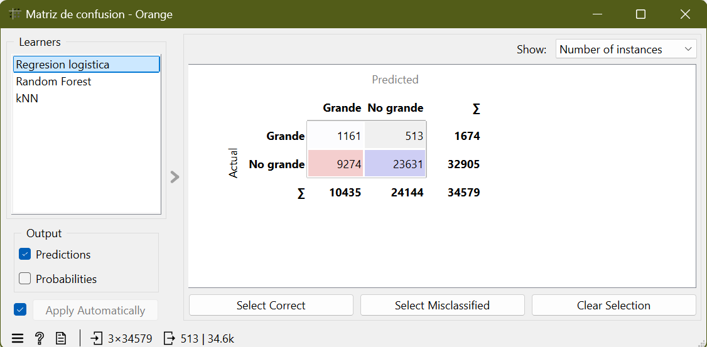
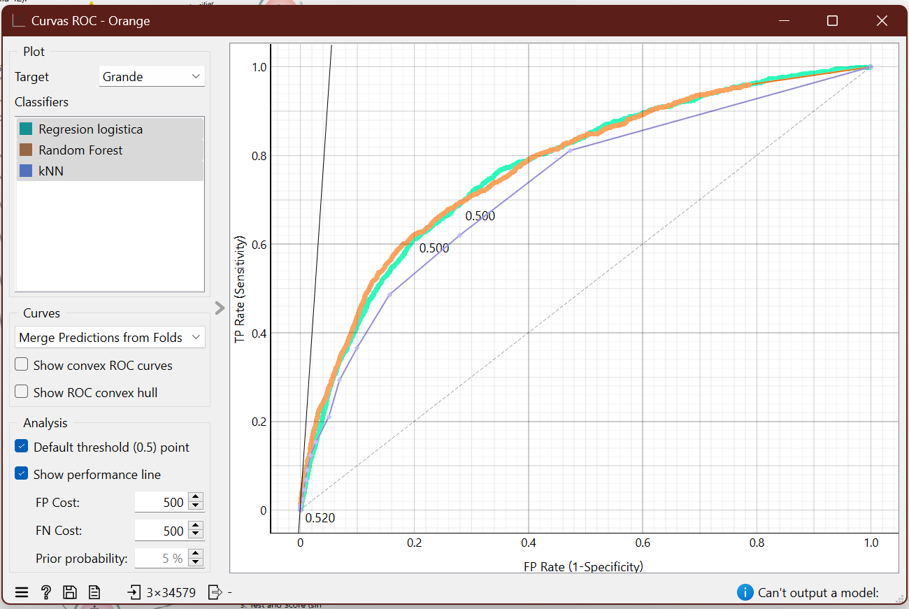
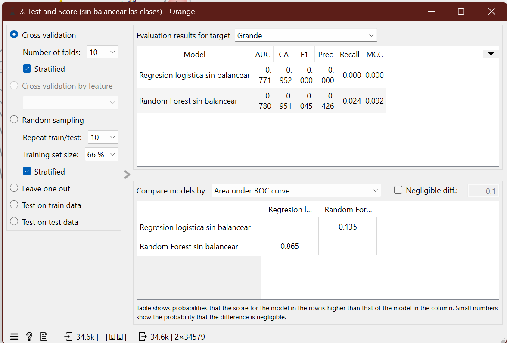
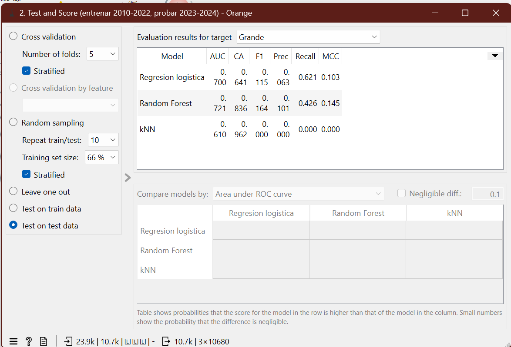
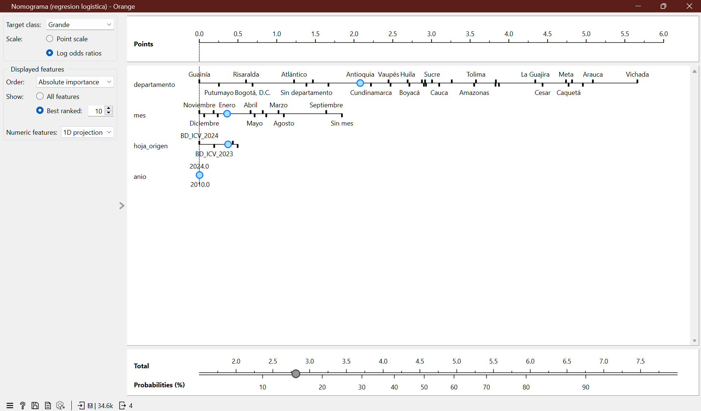

# Aprendizaje supervisado: ¿puede predecirse que un incendio será grande?

Sección 1 del informe de la Etapa 6 (Conocimiento Oculto). Autora: Sara Vargas.

## 1. Pregunta y objetivo

**Pregunta de predicción:** dado un incendio de cobertura vegetal reportado, con la información disponible al momento del reporte (año, mes, departamento y hoja de origen del registro), ¿puede predecirse si será **grande**, es decir, de más de 100 hectáreas?

**Tipo de problema: clasificación binaria.** La variable objetivo es una categoría (`Grande` / `No grande`). Se eligió clasificación y no regresión por dos razones: el área de los incendios es muy asimétrica (mediana de 2 ha y promedio de 46,6 ha en todo el conjunto), de modo que predecir el valor exacto en hectáreas daría un error dominado por unos pocos eventos extremos; y lo que importa para la gestión es anticipar los eventos extensos, que son la minoría. El umbral de 100 ha es el mismo que se usó en las vistas de la Etapa 5 ("incendio grande").

**Objetivo de la sección:** implementar tres modelos supervisados distintos para esta pregunta, evaluarlos en las mismas condiciones, compararlos, elegir uno y describir qué conocimiento aporta y cuáles son sus límites.

## 2. Datos y transformaciones

**Origen:** `data/processed/incendios_ideam_tratado_2010_2024.csv`, el CSV tratado en la Etapa 2 (35.355 eventos de la BD-ICV del IDEAM, 2010-2024). La preparación se hace con `scripts/etapa6/preparar_supervisado.py`, que escribe `data/etapa6/supervisado/incendios_supervisado.tab` (formato nativo de Orange, con la clase y el identificador ya marcados).

| Paso | Eventos | Motivo |
|---|---|---|
| CSV tratado | 35.355 | Punto de partida |
| Sin área informada (se descartan) | −775 | Sin el área no se puede saber si el incendio fue grande; el área nula no se convierte en 0 |
| Sin año (se descarta) | −1 | El año es una predictora |
| **Archivo para Orange** | **34.579** | |

**Variable objetivo `clase`:** `Grande` si el área total supera 100 ha. Resultado: **1.674 eventos grandes (4,84 %)** y 32.905 no grandes (95,16 %).

**Predictoras (4):** `anio` (numérica), `mes` (categórica; "Sin mes" para los nulos, 13 categorías), `departamento` (categórica; "Sin departamento" para los nulos, 34 categorías) y `hoja_origen` (categórica, 5 categorías: la hoja del libro del IDEAM de donde viene el registro). El identificador `id_evento` va como metadato y no entra al modelo.

**Variables excluidas y por qué.** Se evitó usar información que no estaría disponible al predecir y que contiene la respuesta:

| Variables | Motivo de la exclusión |
|---|---|
| `AREA_*_HA`, `AREA_TOTAL_HA`, `AREA_TOTAL_HA_NUM`, `AREA_*_NUM` | Expresan el área: contienen la respuesta (fuga de información) |
| `AREA_TOTAL_ATIPICO` | Se deriva del área: los 1.674 eventos grandes están todos marcados |
| `COB_*`, `COB_*_NUM` | Hectáreas por tipo de cobertura: expresan el área (fuga de información) |
| `CAUSA_*` | Se conoce después del evento y falta en la mayoría de los registros |
| `LATITUD_DEC`, `LONGITUD_DEC`, `ELEVACION_MSNM_NUM` | Nulas en el 97 % de los eventos con área |
| `AREA_PROTEGIDA_NACIONAL` | Nula en el 98 % de los eventos con área y con respuestas inconsistentes |
| `MUNICIPIO_NORM` | Más de mil categorías para el tamaño de la muestra |
| `ENTIDAD_REPORTA` | Solo existe en la hoja 2024 |

**Desbalance de clases.** Solo el 4,84 % de los eventos es grande. Un modelo que respondiera siempre "No grande" tendría una exactitud (accuracy) de **95,16 %** sin detectar ningún incendio grande. Por eso la exactitud no sirve como criterio: se usan AUC, precisión, recall y F1 de la clase `Grande`, además de la matriz de confusión.

## 3. Flujo de Orange

Archivo: `orange/supervisado/modelos_supervisados.ows` (Orange 3.40.0). Se genera con `scripts/etapa6/generar_flujo_supervisado.py` y los datos se cargan con una ruta relativa (`../../data/etapa6/supervisado/incendios_supervisado.tab`).



*Figura 1. Flujo completo en Orange (`modelos_supervisados.ows`). A la izquierda, el widget File carga los 34.579 eventos y alimenta a los tres modelos (regresión logística, Random Forest y kNN). El bloque 1 (arriba) los evalúa con validación cruzada estratificada de 10 pliegues en `Test and Score`, de donde salen la matriz de confusión y las curvas ROC; el nomograma se conecta al modelo de regresión logística. El bloque 2 (centro) usa dos widgets `Select Rows` (año hasta 2022 y año desde 2023) para entrenar con el pasado y probar con datos posteriores. El bloque 3 (abajo) repite la regresión logística y el Random Forest sin balancear las clases. Los triángulos amarillos sobre los dos modelos balanceados son el aviso de Orange de que se activó "Balance class distribution", lo cual es intencional.*

| Widget | Conexión (de → a) | Parámetros |
|---|---|---|
| **File** | Data → los tres modelos, Test and Score 1 y 3, Nomogram y los dos Select Rows | `incendios_supervisado.tab`; `clase` como variable objetivo; `id_evento` como metadato |
| **Logistic Regression** | Data ← File; Learner → Test and Score 1 y 2; Model → Nomogram | Regularización Ridge (L2), C = 1, *Balance class distribution* activado |
| **Random Forest** | Data ← File; Learner → Test and Score 1 y 2 | 300 árboles, no dividir subconjuntos menores de 20, *Balance class distribution* y *Replicable training* activados; el resto por defecto |
| **kNN** | Data ← File; Learner → Test and Score 1 y 2 | 25 vecinos, métrica euclidiana, peso uniforme (no admite balanceo de clases) |
| **Test and Score 1** | Learner ← los tres modelos; Data ← File; Evaluation Results → Confusion Matrix y ROC Analysis | Validación cruzada estratificada de 10 pliegues (semilla 42); clase objetivo `Grande` |
| **Confusion Matrix** | Evaluation Results ← Test and Score 1 | Se examina un modelo a la vez |
| **ROC Analysis** | Evaluation Results ← Test and Score 1 | Clase objetivo `Grande` |
| **Nomogram** | Classifier ← Logistic Regression (Model); Data ← File | Clase objetivo `Grande` |
| **Select Rows** (2) | Data ← File; Matching Data → Test and Score 2 | `anio` es como máximo 2022 (entrenamiento) y `anio` es al menos 2023 (prueba) |
| **Test and Score 2** | Learner ← los tres modelos; Data y Test Data ← Select Rows | *Test on test data* |
| **Logistic Regression** y **Random Forest** sin balancear | Data ← File; Learner → Test and Score 3 | Mismos parámetros, con *Balance class distribution* desactivado |
| **Test and Score 3** | Learner ← los dos modelos sin balancear; Data ← File | Validación cruzada estratificada de 10 pliegues (semilla 42) |

Los tres modelos reciben los mismos datos y se evalúan con la misma partición, así que la comparación es consistente. Orange aplica a cada modelo su preprocesamiento por defecto (codificación de las categóricas, imputación de nulos).

## 4. Resultados

**Configuración de la comparación principal:** validación cruzada estratificada de 10 pliegues con semilla 42. Clase de interés: `Grande`.

### 4.1 Comparación de los tres modelos

| Modelo | AUC | Exactitud | F1 | Precisión | Recall |
|---|---|---|---|---|---|
| Regresión logística | 0,772 | 0,717 | 0,192 | 0,111 | 0,694 |
| Random Forest | 0,774 | 0,790 | 0,223 | 0,136 | 0,622 |
| kNN | 0,730 | 0,951 | 0,024 | 0,318 | 0,013 |

Matriz de confusión (clase `Grande`; filas = real, columnas = predicho):

| Modelo | Detectados (VP) | No detectados (FN) | Falsas alarmas (FP) | No grandes bien clasificados (VN) |
|---|---|---|---|---|
| Regresión logística | 1.161 | 513 | 9.274 | 23.631 |
| Random Forest | 1.041 | 633 | 6.623 | 26.282 |
| kNN | 21 | 1.653 | 45 | 32.860 |



*Figura 2. `Test and Score` con validación cruzada estratificada de 10 pliegues y la clase objetivo `Grande` (arriba a la derecha). Cada fila es un modelo y las columnas son AUC, CA (exactitud), F1, precisión, recall y MCC. El AUC de la regresión logística y del Random Forest es casi igual (0,772 y 0,774); el kNN tiene exactitud alta (0,951) pero recall de 0,013; la regresión logística tiene el mayor recall (0,694). La tabla inferior compara los modelos por AUC: la probabilidad de que el Random Forest supere a la regresión logística es de solo 0,601, es decir, no hay una diferencia clara entre ambos.*



*Figura 3. Matriz de confusión de la regresión logística (modelo elegido) con la opción "Number of instances". De los 1.674 incendios grandes reales, 1.161 se detectan y 513 no (recall de 0,694); de los 32.905 no grandes, 9.274 se marcan como grandes (falsas alarmas) y 23.631 se clasifican bien. El modelo señala 10.435 eventos como grandes y solo 1.161 lo son (precisión de 0,111): por cada incendio grande detectado hay unas 8 falsas alarmas.*



*Figura 4. Curvas ROC de los tres modelos para la clase `Grande`, con las predicciones de todos los pliegues. La regresión logística (verde azulado) y el Random Forest (naranja) casi se superponen y quedan claramente por encima de la diagonal punteada (azar); la curva del kNN (violeta) queda por debajo en casi todo el recorrido. Los puntos marcados "0,500" son el umbral de decisión por defecto: la regresión logística (recall de 0,694) queda con cerca de 28 % de falsas alarmas entre los eventos no grandes (9.274 de 32.905) y el Random Forest (recall de 0,622) con cerca de 20 % (6.623 de 32.905); el punto del kNN queda pegado al origen.*

**Cómo leer el desbalance.** La exactitud de kNN (0,951) parece excelente y casi coincide con la línea base (0,9516), pero solo detecta 21 de los 1.674 incendios grandes (recall de 1,3 %). Los dos modelos que balancean las clases tienen una exactitud menor (0,72 y 0,79) y, sin embargo, detectan entre el 62 % y el 69 % de los incendios grandes: aceptan más falsas alarmas a cambio de no dejar pasar los eventos extensos. Con el 4,84 % de positivos, la precisión es baja en todos los casos: la regresión logística acierta en 1 de cada 9 alertas (precisión de 0,111), unas 8 falsas alarmas por incendio grande detectado; el Random Forest, unas 6.

### 4.2 Sensibilidad al desbalance: los mismos algoritmos sin balancear las clases

| Modelo | AUC | Exactitud | F1 | Precisión | Recall |
|---|---|---|---|---|---|
| Regresión logística sin balancear | 0,771 | 0,952 | 0,000 | 0,000 | 0,000 |
| Random Forest sin balancear | 0,780 | 0,951 | 0,045 | 0,426 | 0,024 |

Sin balancear, la regresión logística no detecta ningún incendio grande (0 de 1.674) y su exactitud de 0,952 coincide con la de la línea base. Su AUC casi no cambia (0,771 frente a 0,772): el modelo **ordena** igual de bien los eventos, pero con el umbral por defecto nunca los clasifica como grandes. Esto muestra que el desbalance afecta a las métricas de decisión (recall, F1, matriz de confusión), no a la capacidad de ordenar por riesgo.



*Figura 5. `Test and Score 3`: los mismos algoritmos sin balancear las clases, con la misma validación. La regresión logística tiene AUC 0,771 y exactitud 0,952, pero F1, precisión y recall de 0,000: nunca clasifica un evento como grande. El Random Forest sin balancear tiene AUC 0,780 y recall de 0,024. La exactitud de 0,95 es igual a la de la línea base, por eso no sirve como criterio en este problema.*

### 4.3 Verificación temporal: entrenar con 2010-2022 y probar en 2023-2024

Entrenamiento: 23.899 eventos (1.273 grandes). Prueba: 10.680 eventos (401 grandes, 3,75 %).

| Modelo | AUC | Exactitud | F1 | Precisión | Recall |
|---|---|---|---|---|---|
| Regresión logística | 0,700 | 0,641 | 0,115 | 0,063 | 0,621 |
| Random Forest | 0,721 | 0,836 | 0,164 | 0,101 | 0,426 |
| kNN | 0,610 | 0,962 | 0,000 | 0,000 | 0,000 |

Con datos futuros el desempeño baja en los tres modelos (el AUC de la regresión logística cae de 0,772 a 0,700 y el del Random Forest de 0,774 a 0,721), lo que indica que parte de lo aprendido en la validación cruzada depende del periodo: el reporte cambia entre hojas de origen y años.



*Figura 6. `Test and Score 2` con la opción "Test on test data": entrenamiento con 23,9 mil eventos de 2010-2022 y prueba con 10,7 mil de 2023-2024 (indicadores de la barra inferior). Con datos posteriores el AUC baja a 0,700 (regresión logística) y 0,721 (Random Forest); el recall del Random Forest cae a 0,426 y el kNN no detecta ningún incendio grande.*

### 4.4 Qué variables pesan

Tasa observada de incendios grandes (sobre eventos con área; el promedio general es 4,84 %):

| Departamento | Grandes | Eventos | Tasa |
|---|---|---|---|
| Vichada | 93 | 360 | 25,8 % |
| Arauca | 92 | 437 | 21,1 % |
| Casanare | 235 | 1.485 | 15,8 % |
| Meta | 194 | 1.358 | 14,3 % |
| Caquetá | 49 | 348 | 14,1 % |
| Bogotá, D.C. | 1 | 367 | 0,3 % |
| Risaralda | 1 | 405 | 0,2 % |

(Solo se listan departamentos con al menos 100 eventos.) Por mes, marzo (7,0 %), febrero (6,6 %) y septiembre (5,9 %) concentran la mayor proporción de incendios grandes, frente a junio, julio y noviembre (1,9 %). Por hoja de origen, 2022 (8,8 %) y 2021 (7,4 %) superan a 2024 (3,6 %).

En la regresión logística (balanceada) los coeficientes de mayor tamaño son los de departamento. Valores en logaritmo de las razones de probabilidades para la clase `Grande` (positivo = más probabilidad de ser grande, con el resto de variables iguales): Vichada (+2,71), Arauca (+2,13), Casanare (+1,86), Caquetá (+1,82) y Meta (+1,78); y, en el sentido contrario, Guainía (−2,95), Putumayo (−2,70), Risaralda (−2,35) y Bogotá, D.C. (−2,27). Entre los meses, una vez descontado el departamento, el más alto es septiembre (+0,90), seguido de agosto (+0,35) y marzo (+0,29), y los más bajos noviembre (−0,74), diciembre (−0,67), julio (−0,55) y junio (−0,50). El año (−0,0002 por año) y la hoja de origen (entre −0,32 y +0,18) casi no aportan. Orange calcula los coeficientes respecto a la segunda clase del archivo (`No grande`); aquí se muestran con el signo invertido para leerlos respecto a `Grande`, que es como los presenta el widget Nomogram con la clase objetivo `Grande`.



*Figura 7. Nomograma de la regresión logística para la clase `Grande`, con la escala en logaritmo de las razones de probabilidades. Las variables están ordenadas por importancia: el departamento abarca el rango más amplio (desde Guainía, el más bajo, hasta Vichada, el más alto, unas 5,7 unidades), seguido del mes (septiembre y "Sin mes" arriba; noviembre y diciembre abajo), la hoja de origen (rango pequeño) y el año (casi nulo). El punto azul marca el valor seleccionado en cada variable y la barra inferior convierte la suma de puntos en una probabilidad.*

## 5. Modelo seleccionado

**Se selecciona la regresión logística (con clases balanceadas).** Razones:

- **Desempeño:** su AUC (0,772) es prácticamente igual al del Random Forest (0,774); la diferencia de 0,002 no es clara: la comparación por AUC de Orange (figura 2) da solo 0,601 de probabilidad de que el Random Forest supere a la regresión logística. Es el modelo con mayor recall (0,694): detecta 1.161 de los 1.674 incendios grandes, 120 más que el Random Forest.
- **Errores que comete:** deja pasar el 31 % de los incendios grandes (513 falsos negativos) y genera 9.274 falsas alarmas. En este problema un falso negativo es más costoso que una falsa alarma, porque un incendio extenso que no se anticipa es el caso que más daño causa; por eso se privilegia el recall.
- **Interpretación:** sus coeficientes y el nomograma dicen qué departamentos, meses y hojas aumentan o reducen la probabilidad de un incendio grande; el Random Forest no ofrece esa lectura directa.
- **Utilidad:** sirve para priorizar la vigilancia: ordenar los departamentos y meses por riesgo y reforzar el seguimiento donde la probabilidad es mayor.

**Por qué no el Random Forest:** tiene mejor F1 (0,223 frente a 0,192), mayor precisión (0,136 frente a 0,111), menos falsas alarmas (6.623 frente a 9.274) y se degrada menos con datos futuros (AUC de 0,721 frente a 0,700). Sería la mejor opción si el costo de una falsa alarma fuera alto. Aunque la importancia de variables del Random Forest también pone primero al departamento (51,7 %), le asigna 24,0 % al año, que en la regresión logística casi no pesa (−0,0002 por año): las importancias de los bosques de árboles suelen favorecer a las variables numéricas, por lo que se interpretan con más cautela que los coeficientes de la regresión logística. **Por qué no kNN:** detecta solo el 1,3 % de los incendios grandes y no admite balanceo de clases.

**Qué conocimiento aporta:** frente al conocimiento evidente de las etapas anteriores (donde se contaban eventos y hectáreas por región), el modelo cuantifica que **la probabilidad de que un incendio sea grande depende sobre todo del departamento**, con las tasas más altas en los llanos orientales (Vichada, Arauca, Casanare y Meta) y en Caquetá, y que dentro del año se concentra en febrero, marzo y septiembre (tasas observadas); al descontar el departamento, el mes con más peso es septiembre.

## 6. Limitaciones y qué es hipótesis

- **Pocas predictoras.** Solo hay cuatro variables disponibles de forma confiable; no hay clima, vegetación ni condiciones del terreno. Un AUC de 0,77 es moderado y la precisión es baja (11 %).
- **El umbral de decisión.** Balancear las clases cambia la decisión (recall alto, precisión baja) y las probabilidades no están calibradas; el umbral debería ajustarse al costo real de una falsa alarma.
- **Cambio de periodo.** La verificación temporal baja el AUC a 0,70-0,72: el modelo no es estable frente al cambio de reporte entre hojas y años.
- **Asociación no es causalidad.** Que Vichada o Arauca tengan más incendios grandes no significa que el departamento los cause. **Hipótesis (sin comprobar con estos datos):** la proporción alta en los llanos podría reflejar vegetación de sabana abierta, donde el fuego se propaga con facilidad, o diferencias en la capacidad de respuesta y de reporte. Requiere datos de vegetación, clima y respuesta.
- **El área es lo reportado.** La clase se define con el área informada, que puede variar entre hojas y años; los 775 eventos sin área no participan.

## 7. Cómo reproducirlo

Desde la raíz del repositorio (con el Python que trae Orange 3.40 para los dos últimos pasos):

```bash
python scripts/etapa6/preparar_supervisado.py
<carpeta de Orange>\python.exe scripts/etapa6/evaluar_supervisado.py
<carpeta de Orange>\python.exe scripts/etapa6/generar_flujo_supervisado.py
```

1. `preparar_supervisado.py` genera `data/etapa6/supervisado/incendios_supervisado.tab` (34.579 eventos).
2. `evaluar_supervisado.py` calcula, con las clases de aprendizaje de Orange, las métricas de las secciones 4.1 a 4.3 y las guarda en `data/etapa6/supervisado/metricas_esperadas.csv`.
3. Para ver el flujo, abrir `orange/supervisado/modelos_supervisados.ows` en Orange 3.40 (los datos se cargan con una ruta relativa). Los resultados de *Test and Score* coinciden con la tabla de las secciones 4.1 a 4.3.

## 8. Resumen para las conclusiones integradas

- **Hallazgo 1 (evidencia):** solo el 4,84 % de los incendios con área es grande (1.674 de 34.579); un modelo que siempre dijera "No grande" tendría 95,16 % de exactitud sin detectar ninguno, por lo que se evalúa con recall, precisión, F1 y AUC.
- **Hallazgo 2 (evidencia):** con año, mes, departamento y hoja de origen, la regresión logística balanceada alcanza AUC 0,772 y detecta el 69,4 % de los incendios grandes (1.161 de 1.674) con 9.274 falsas alarmas (precisión 11,1 %); el Random Forest obtiene AUC 0,774 y recall 62,2 %.
- **Hallazgo 3 (evidencia):** el departamento es la variable que más pesa. Las tasas más altas de incendios grandes son las de Vichada (25,8 %), Arauca (21,1 %), Casanare (15,8 %) y Meta (14,3 %), frente a 4,84 % general; por mes, marzo, febrero y septiembre (7,0 %, 6,6 % y 5,9 %).
- **Limitación:** con datos de 2023-2024 el AUC baja a 0,70-0,72; el modelo se apoya en pocas variables y el área es la reportada.
- **Hipótesis por validar:** que la alta proporción de incendios grandes en los llanos se deba a la vegetación de sabana abierta o a diferencias de respuesta; requiere datos de vegetación y clima.
