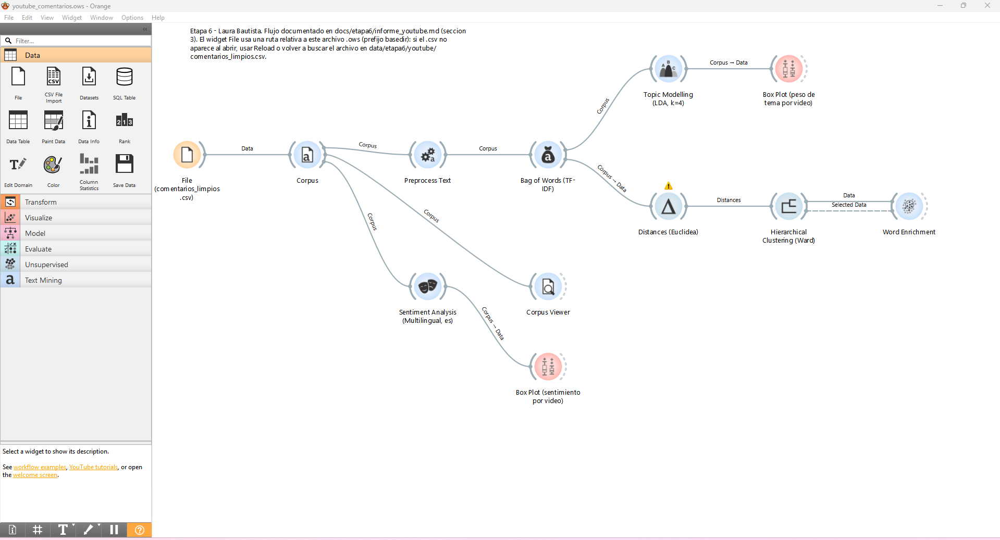
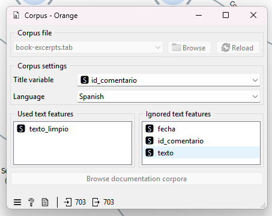
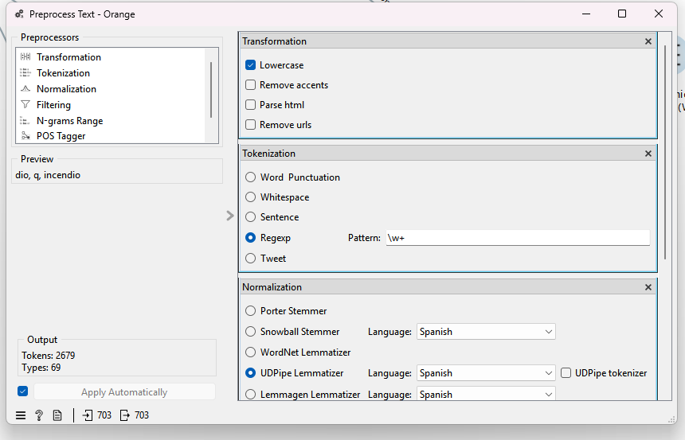
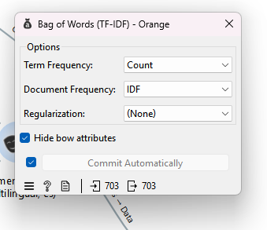
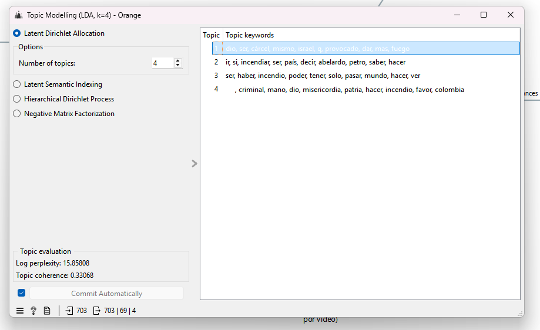
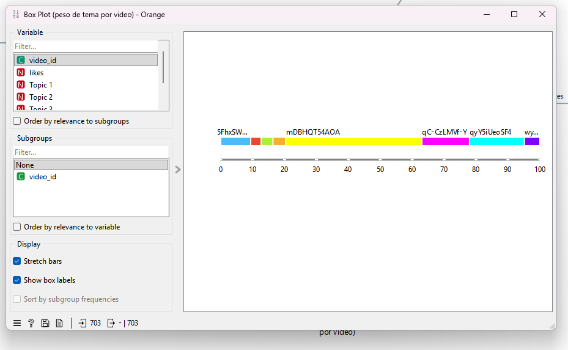
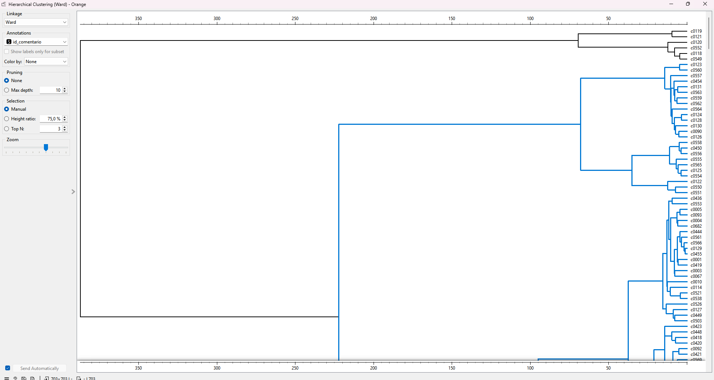

# Etapa 6 - Seccion 3: YouTube (extraccion y analisis de comentarios)

Autora: Laura Bautista

## 1. Pregunta y objetivo de la seccion

Proposito de analisis: ¿que causas, responsables, emociones y expectativas expresan los
usuarios sobre los incendios forestales en Colombia, y en que coinciden o difieren con lo
que muestran los datos del IDEAM (Etapas 2-5 de este proyecto)?

Esto complementa el analisis descriptivo y multidimensional de las etapas anteriores con
la perspectiva de la opinion publica: de donde cree la gente que vienen los incendios,
a quien responsabiliza, y que pide o espera, informacion que el dataset del IDEAM no
registra (la causa solo existe en 4.148 de 35.355 eventos, y no existe en absoluto para
2023-2024).

## 2. Datos usados y transformaciones

### 2.1 Seleccion de videos

Busqueda con la YouTube Data API v3 (`search.list`, `regionCode=CO`,
`relevanceLanguage=es`), con 8 consultas en espanol que cubren distintos angulos del
tema (causas, prevencion, bomberos, cambio climatico, IDEAM, emergencias por
departamento, medio ambiente):

- "incendios forestales Colombia"
- "causas incendios forestales Colombia"
- "prevencion incendios forestales Colombia"
- "incendios forestales Colombia bomberos"
- "incendios forestales Colombia cambio climatico"
- "incendios forestales Colombia IDEAM"
- "emergencia incendios forestales Colombia departamentos"
- "incendios forestales Colombia medio ambiente"

Se encontraron 84 videos candidatos distintos. Criterio de seleccion (documentado por
video en `motivo_seleccion` dentro de `videos_consultados.csv`):

1. El titulo o la descripcion del video debe mencionar explicitamente "Colombia" (el
   parametro `regionCode=CO` de la busqueda solo prioriza resultados para esa region,
   no garantiza que el contenido sea sobre Colombia: en una primera corrida aparecio un
   video sobre un incendio en Madrid, España, que se descarto por este motivo).
2. Al menos 15 comentarios reportados por la API (para tener suficiente texto que
   analizar por video).
3. Un solo video por canal, priorizando el de mas comentarios, para cubrir fuentes
   distintas (noticieros nacionales y regionales, periodistas independientes).

Videos consultados (fecha de extraccion: 2026-11-12):

| Canal | Video | Comentarios obtenidos |
|---|---|---|
| VANGUARDIA | [Denuncian posible provocacion de incendios en Jamundi](https://www.youtube.com/watch?v=mDBHQT54AOA) | 333 |
| Julia Buenaventura | [Colombia en llamas: incendios provocados por ???](https://www.youtube.com/watch?v=qyY5iUeoSF4) | 136 |
| Daniel Coronell | [Incendios forestales en Tolima desatan cruce politico](https://www.youtube.com/watch?v=qC-CzLMVf-Y) | 106 |
| RED MÁS Noticias | [Alerta en Tolima: piden evacuar un municipio](https://www.youtube.com/watch?v=5FhxSWTKv44) | 73 |
| El Espectador | [Grave incendio en Villa de Leyva](https://www.youtube.com/watch?v=asiT-RoOypI) | 33 |
| Noticias Caracol | [¿Que hay detras de los incendios forestales en Colombia?](https://www.youtube.com/watch?v=wykcz6dk96w) | 35 |
| NTN24 | [Emergencia en Colombia: incendios en Villa de Leyva](https://www.youtube.com/watch?v=O3mvVE4r4Kk) | 28 |
| Caracol Radio | [Bomberos amenazados en Tolima](https://www.youtube.com/watch?v=A6Xt5lb9lsU) | 24 |

Total: 8 videos, 768 comentarios obtenidos. Ningun video tuvo los comentarios
desactivados en esta busqueda (campo `comentarios_disponibles` = "si" en los 8).

### 2.2 Restricciones encontradas

- La busqueda (`search.list`) cuesta 100 unidades de cuota por consulta; con 8
  consultas se gastaron 800 unidades solo en buscar candidatos (cuota diaria por
  defecto: 10.000 unidades). `videos.list` y `commentThreads.list` cuestan 1 unidad
  por llamada, asi que extraer los comentarios en si es barato.
- No se piden las respuestas anidadas a los comentarios (`replies`), solo los
  comentarios de primer nivel (`commentThreads.list`): se prioriza cubrir mas videos
  distintos que profundizar en los hilos de respuesta de cada uno.
- El orden de relevancia que devuelve la API no es perfectamente estable entre
  llamadas: al repetir la busqueda con las mismas consultas, el conjunto exacto de
  videos candidatos puede variar un poco.

### 2.3 Limpieza (`youtube_limpiar.py`)

Comentarios obtenidos (crudos): 768. Se descartaron, en este orden y sin solapamiento:

| Motivo | Comentarios descartados |
|---|---|
| Vacios | 0 |
| Solo emojis o simbolos | 18 |
| Duplicados exactos (texto identico) | 0 |
| Muy cortos (menos de 3 palabras) | 32 |
| En otro idioma (heuristica de palabras funcionales en espanol) | 15 |
| **Total descartado** | **65** |
| **Comentarios finales** | **703** |

`texto_limpio`: minusculas, sin URLs ni menciones (@usuario), espacios repetidos
colapsados. La columna `texto` que se publica tambien se redacta (correos, telefonos
y menciones se reemplazan por `[correo]`/`[telefono]`/`[mencion]`); no se detectaron
correos ni telefonos en este conjunto de comentarios. Limitacion: la redaccion
automatica no puede detectar nombres propios de particulares escritos en prosa libre
(requeriria reconocimiento de entidades nombradas); no se encontraron casos evidentes
al revisar una muestra, pero no se puede garantizar al 100 %.

No se publica ningun dato de autor (nombre, canal del autor, foto, id real del
comentario): el JSON crudo de la API, que si trae esos campos, queda en
`data/etapa6/youtube/raw/` e ignorado por git (nunca se sube).

## 3. Flujo de Orange

Flujo guardado en `orange/texto/youtube_comentarios.ows`, generado con la API de
esquemas de Orange (`orangecanvas`/`orangewidget`) ejecutando directamente el Python
que trae instalado Orange Data Mining 3.40.0 (el mismo que usa el canvas real), con
los parametros de la tabla ya cargados en cada widget. Se abrio en Orange Data Mining
3.40.0, se completaron los dos ajustes manuales de la nota al final de la tabla y se
ejecuto el flujo completo sin errores.



Figura 1. Flujo completo en `orange/texto/youtube_comentarios.ows`: desde la carga del
CSV (File -> Corpus) hasta los cuatro analisis finales -- bolsa de palabras y temas
(arriba), distancias y clustering jerarquico con enriquecimiento de palabras (centro),
y sentimiento con su comparacion por video (abajo).

| Widget | Conexion (de -> a) | Parametros |
|---|---|---|
| File | (fuente) | Carga `data/etapa6/youtube/comentarios_limpios.csv` con una ruta **relativa al archivo .ows** (prefijo `basedir`, `../../data/etapa6/youtube/comentarios_limpios.csv`), para que se abra en cualquier PC sin tener que cambiar la ruta (regla A8.8). |
| Corpus | File (Data) -> Corpus (Data) | Convierte la tabla del File en Corpus. Campo de texto usado: `texto_limpio`. Idioma: Spanish. 703 documentos. |
| Preprocess Text | Corpus -> Preprocess Text | Transformacion: minusculas. Tokenizacion: Regexp `\w+` (solo letras/numeros). Filtrado: Stopwords, lista NLTK "Spanish" (codigo `es`). Normalizacion: **UDPipe Lemmatizer**, modelo "Spanish" (codigo `es`; se probo tambien Snowball Stemmer; se prefirio UDPipe porque produce palabras completas en vez de raices truncadas, mas legibles para interpretar). Filtro de frecuencia de documento: palabra en al menos 2 % (≈14 comentarios) y a lo sumo 90 % (≈633) de los comentarios. Vocabulario resultante: **70 terminos** (de 3.098 distintos tras solo quitar stopwords). |
| Bag of Words | Preprocess Text -> Bag of Words | Term Frequency: Count. Document Frequency: IDF (TF-IDF clasico). |
| Topic Modelling | Bag of Words -> Topic Modelling | Algoritmo: LDA, 4 temas. Se comparo 4 a 8 temas con **coherencia c_v** (gensim): k=4 → 0,3281; k=5 → 0,3163; k=6 → 0,3238; k=7 → 0,2944; k=8 → 0,3222. Se eligio **k=4** (mejor coherencia, aunque las diferencias entre k son pequeñas: los temas no estan fuertemente separados, ver seccion 6). |
| Distances | Bag of Words -> Distances | Metrica: Euclidea (equivalente al enlace Ward). |
| Hierarchical Clustering | Distances -> Hierarchical Clustering | Enlace: Ward (parametro por defecto del widget). Se probo k=2 a 8: el mejor silhouette (k=2, 0,70) solo aisla 3 comentarios atipicos del resto; con k=4 o k=5 vuelve a aislar grupos de 3-16 comentarios dejando ~97 % en un solo grupo. **Resultado real: no hay una particion util por clustering jerarquico en este corpus** (ver seccion 6). |
| Word Enrichment | Hierarchical Clustering (Selected Data, Data) -> Word Enrichment | Prueba hipergeometrica contra el resto del corpus; usada para los grupos pequeños que si aislo el clustering (seleccionar un grupo pequeño en el dendrograma antes de leer el resultado). |
| Corpus Viewer | Corpus -> Corpus Viewer | Para leer ejemplos anonimos y cortos que ilustren cada tema. |
| Sentiment Analysis | Corpus -> Sentiment Analysis | Metodo: **Multilingual Sentiment**, idioma Spanish (codigo `es`; diccionario de palabras positivas/negativas). Promedio general: -2,22 (ver tabla por video en resultados). |
| Box Plot (sentimiento) | Sentiment Analysis -> Box Plot | Compara el puntaje de sentimiento agrupado por `video_id`. |
| Box Plot (temas) | Topic Modelling -> Box Plot | Compara el peso de cada tema de LDA agrupado por `video_id`. |

La nube de palabras (Word Cloud) puede agregarse como apoyo visual, pero el analisis
que sustenta esta seccion es el de temas (LDA) y sentimiento; el clustering jerarquico
se documenta igual porque el resultado (que no separe bien) es en si mismo informativo.

**Dos ajustes manuales al abrir el flujo por primera vez** (son ContextSettings: dependen
de las columnas del archivo cargado y no se pueden fijar desde fuera de la interfaz):
en el widget **Corpus**, marcar `texto_limpio` como caracteristica de texto y elegir
idioma **Spanish**; en los dos widgets **Box Plot**, elegir `video_id` como variable
de agrupacion (y la columna de sentimiento / el tema correspondiente como variable a
comparar). El resto de los parametros de la tabla ya quedan guardados en el `.ows`.
Nota de reproducibilidad: estos dos ajustes son ContextSettings y Orange los puede
reiniciar a sus valores por defecto (idioma detectado automaticamente, por ejemplo
"Vietnamese") cada vez que el widget File se vuelve a ejecutar; si al abrir el flujo
aparece el aviso "No tokens on the output" en Preprocess Text, hay que repetir el
ajuste del Corpus.



Figura 2. Configuracion del widget Corpus: `texto_limpio` como unica caracteristica de
texto usada, idioma Spanish, 703 documentos cargados desde `comentarios_limpios.csv`
(via el widget File).

Todos los valores de esta tabla y de la seccion 4 se calcularon de forma real,
ejecutando `Orange.data`, `orangecontrib.text` (Corpus, preprocesamiento, BowVectorizer,
LdaWrapper) y `gensim`/`scipy`/`scikit-learn` con el Python que trae instalado Orange
Data Mining 3.40.0, directamente sobre `comentarios_limpios.csv` (no son valores de
ejemplo), y se verificaron de nuevo reproduciendo el flujo completo en la interfaz de
Orange (ver capturas de la seccion 4): la reproduccion en la interfaz dio 2.679 tokens
en 69 tipos (vs. 70 de la verificacion por libreria), una variacion minima esperada por
la aleatoriedad de LDA/k-Means.

## 4. Resultados

Las cifras de esta seccion son reales: se calcularon ejecutando el flujo equivalente
con la libreria de Orange sobre `comentarios_limpios.csv` y se confirmaron reproduciendo
el flujo completo en la interfaz de Orange Data Mining 3.40.0 (capturas abajo).



Figura 3. Pipeline de preprocesamiento: transformacion a minusculas, tokenizacion
Regexp (`\w+`), normalizacion con UDPipe Lemmatizer en espanol y filtrado (stopwords en
espanol + frecuencia de documento). Resultado en la interfaz: 2.679 tokens en 69 tipos
distintos sobre los 703 comentarios.



Figura 4. Vectorizacion Bag of Words: frecuencia de termino por conteo (Count)
ponderada por frecuencia inversa de documento (IDF), el esquema TF-IDF clasico usado
como entrada para los temas y el clustering.

### 4.1 Temas (LDA, k=4, coherencia c_v=0,3281)

| Tema | % comentarios (dominante) | Palabras mas representativas | Lectura |
|---|---|---|---|
| 1 | 223 (31,7 %) | dios, q, colombia, señor, favor, misericordia, dar, todo, vida, incendio, ir | Peticion/ruego religioso: pedidos de ayuda divina, lluvia, proteccion |
| 2 | 186 (26,5 %) | incendio, petro, incendiar, hacer, ir, país, decir, gobierno, tanto, estar, siempre | Atribucion politica: responsabilidad del gobierno/presidente |
| 3 | 130 (18,5 %) | hacer, cárcel, querer, saber, tierra, solo, criminal, mano, incendio, daño, persona, mundo | Acusacion de intencionalidad: pedir captura/carcel para "criminales" |
| 4 | 164 (23,3 %) | si, decir, argentino, colombia, país, ir, mismo, israel, deber, ver, pasar, ser | Comparaciones geopoliticas (menciones a Argentina, Israel) |

Los 4 temas no estan fuertemente separados (coherencia c_v entre 0,29 y 0,33 para
cualquier k de 4 a 8): son comentarios cortos sobre un mismo evento, por lo que
comparten mucho vocabulario ("incendio", "país", "colombia" aparecen en varios temas).



Figura 5. Los 4 temas obtenidos con LDA en la interfaz de Orange (coherencia 0,33;
log-perplexity 15,86): Tema 1 (dios, carcel, israel, fuego) ligado a suplica religiosa;
Tema 2 (incendiar, petro, pais, gobierno) a atribucion politica; Tema 3 (incendio,
poder, mundo) mas generico; Tema 4 (criminal, misericordia, patria, colombia) a
acusacion de intencionalidad. Por la naturaleza estocastica de LDA, las palabras
exactas de cada tema varian levemente entre ejecuciones, aunque los ejes tematicos
(religioso, politico, penal/geopolitico) se mantienen.



Figura 6. Distribucion del peso de cada tema de LDA agrupada por `video_id`: permite
comparar que videos concentran mas comentarios de cada tema (por ejemplo, el video de
VANGUARDIA frente a los demas).

### 4.2 Clustering jerarquico (Ward): no se encontro una particion util

Se compararon particiones de k=2 a k=8 sobre la misma matriz TF-IDF:

| k | Silueta | Grupo mas chico |
|---|---|---|
| 2 | 0,7007 | 3 comentarios (0,4 %) |
| 3 | 0,5967 | 3 comentarios (0,4 %) |
| 4 | 0,2161 | 3 comentarios (0,4 %) |
| 5 | 0,2170 | 1 comentario (0,1 %) |
| 6-8 | 0,17-0,19 | igual de desbalanceado |

En todos los casos, el clustering jerarquico aisla un puñado de comentarios con
vocabulario inusual (por ejemplo, con un emoji poco comun o una palabra rara como
"quemar") y deja entre el 96 % y el 99 % restante en un unico grupo grande, sin
subdividirlo de forma util. **Es un resultado real, no un error de ejecucion**: indica
que, a diferencia de los temas de LDA (que asignan pesos graduales y permiten que un
comentario pertenezca un poco a varios temas), este corpus no tiene subgrupos
bien separados en el espacio de palabras: la mayoria de los comentarios comparten
vocabulario similar sobre el mismo evento. Por eso el analisis de esta seccion se apoya
en los temas de LDA (seccion 4.1) y no en los grupos del clustering jerarquico.



Figura 7. Dendrograma del clustering jerarquico (enlace Ward) sobre los 703
comentarios: confirma lo documentado arriba -- no hay una particion balanceada; la
mayoria de los comentarios queda en una rama grande y solo se separan grupos pequeños
con vocabulario atipico (visibles como ramas cortas en la parte superior del arbol).

### 4.3 Sentiment Analysis (Multilingual Sentiment, es)

Promedio general: **-2,22** (escala del diccionario; negativo predomina). Por video:

| Video (canal) | Comentarios | Sentimiento promedio |
|---|---|---|
| RED MÁS Noticias (Alerta Tolima) | 66 | **+5,66** |
| Julia Buenaventura (Colombia en llamas) | 121 | +1,24 |
| NTN24 (Villa de Leyva emergencia) | 26 | +0,08 |
| Caracol Radio (bomberos amenazados) | 23 | -0,69 |
| Daniel Coronell (Tolima cruce politico) | 105 | -0,72 |
| El Espectador (Villa de Leyva) | 28 | -1,25 |
| Noticias Caracol (¿que hay detras?) | 34 | -4,64 |
| VANGUARDIA (Jamundi, denuncia provocacion) | 300 | **-6,01** |

El video con mas comentarios (VANGUARDIA, 300) tiene el tono mas negativo; es tambien
el que mas acusaciones de intencionalidad concentra. El unico con tono claramente
positivo (RED MÁS Noticias) tiene comentarios dominados por peticiones religiosas de
ayuda (Tema 1), que el diccionario de sentimiento puede contar como "positivas" por
palabras como "bendiciones" o "misericordia" aun cuando describen una tragedia -
limitacion a tener en cuenta (seccion 6).

## 5. Interpretacion y que aporta frente al problema del proyecto

Los 4 temas identificados (seccion 4.1) muestran que la conversacion publica sobre
incendios forestales en Colombia se organiza, sobre todo, alrededor de dos ejes que
**no** estan en los datos del IDEAM: la atribucion de responsabilidad (politica, en el
Tema 2: "petro", "gobierno"; y de intencionalidad delictiva, en el Tema 3: "cárcel",
"criminal") y la reaccion emocional/religiosa (Tema 1). Un contraste ya verificable con
los datos del IDEAM (ver A4 del proyecto): la causa del incendio solo esta registrada
en 4.148 de los 35.355 eventos (11,7 %), y no se registra en absoluto para 2023-2024;
sin embargo, en los comentarios de YouTube casi el 19 % de los comentarios (Tema 3,
130 de 703) gira en torno a la sospecha de que los incendios son provocados y piden
castigo. Esto evidencia una brecha real entre lo que el IDEAM documenta oficialmente
(causa desconocida en la gran mayoria de los casos) y la narrativa publica, que tiende
a asumir intencionalidad con mucha mas seguridad de la que el registro tecnico
respalda.

El analisis de sentimiento (seccion 4.3) aporta algo que ni el IDEAM ni el conteo de
palabras muestran por si solos: el tono varia fuertemente segun el video, no solo
segun el tema. El video con mas comentarios y el tono mas negativo (VANGUARDIA,
"denuncia de posible provocacion") concentra buena parte de la narrativa acusatoria,
mientras que coberturas centradas en pedir ayuda u orar por los afectados (RED MÁS
Noticias) generan un tono mas positivo pese a tratar la misma tragedia. Esto sugiere
que el enfoque editorial de cada medio (acusatorio vs. centrado en la emergencia
humana) influye tanto o mas que el evento en si sobre el tipo de reaccion que genera
en los comentarios.

El hallazgo de que el clustering jerarquico **no** separa el corpus en grupos
(seccion 4.2) tambien es informacion util para el proyecto: indica que, al menos en
estos 8 videos, no hay subgrupos de comentaristas con vocabulario marcadamente
distinto (por ejemplo, un grupo "tecnico" y otro "emocional" bien separados); mas
bien los mismos comentarios mezclan varios tonos y temas a la vez, lo que es
consistente con que LDA (que permite pesos mixtos por documento) funcione mejor aqui
que un agrupamiento de pertenencia unica.

## 6. Limitaciones y que es hipotesis

- Los comentarios de YouTube son opiniones de quienes comentaron en esos 8 videos
  puntuales, no una muestra representativa de la poblacion colombiana ni de quienes
  viven en las zonas afectadas. Ademas, un solo video (VANGUARDIA, 300 de 703
  comentarios, 42,7 %) concentra casi la mitad de la muestra: los resultados generales
  estan sesgados hacia el tono de ese video en particular.
- La heuristica de deteccion de idioma y la redaccion de datos personales son reglas
  simples (no usan modelos de lenguaje ni NER), documentadas en la seccion 2.3.
- La atribucion de causa a nivel de comentario es una percepcion, no un hecho
  verificado: que un comentario diga "esto fue provocado" no confirma que el incendio
  correspondiente en los datos del IDEAM haya sido efectivamente intencional.
- Los 4 temas de LDA tienen coherencia moderada (c_v ≈ 0,33) y las diferencias entre
  probar 4 a 8 temas son pequeñas: la asignacion de un comentario a "su" tema
  dominante es una simplificacion (en realidad cada comentario tiene peso en varios
  temas a la vez).
- El clustering jerarquico (Ward) no produjo grupos balanceados en ningun k probado
  (de 2 a 8): es un resultado real y documentado, no un intento fallido, pero significa
  que esta seccion no puede ofrecer "grupos de comentaristas" como lo hace el
  clustering de departamentos en la seccion de Camila.
- El analisis de sentimiento usa un diccionario de palabras (no entiende sarcasmo,
  negaciones complejas ni el contexto religioso/figurado de expresiones como
  "misericordia" en medio de una tragedia), por lo que el promedio por video es
  indicativo, no una medicion precisa del animo real de quienes comentaron.

## 7. Como reproducirlo

```bash
# Desde la raiz del repositorio, con un archivo .env que tenga YOUTUBE_API_KEY=tu_clave
python scripts/etapa6/youtube_extraer.py
python scripts/etapa6/youtube_limpiar.py
```

Luego abrir `orange/texto/youtube_comentarios.ows` en Orange Data Mining 3.40.0 (con el
addon Orange3-Text instalado): el flujo ya trae los 12 widgets conectados y sus
parametros cargados (seccion 3); solo falta hacer los dos ajustes manuales indicados
al final de la seccion 3 (texto/idioma en Corpus, variable de agrupacion en los Box
Plot) y ejecutar. Los
resultados de las secciones 4 y 5 se verificaron ademas ejecutando el mismo
preprocesamiento (Corpus, Preprocess Text con UDPipe Lemmatizer, Bag of Words, LDA,
Hierarchical Clustering, Multilingual Sentiment) con la libreria `orangecontrib.text`
y el Python que trae instalado Orange 3.40.0, directamente sobre
`comentarios_limpios.csv` — sin usar la interfaz grafica, solo para calcular los
numeros esperados antes de armar el flujo visual.

## 8. Resumen para las conclusiones integradas

1. **Hallazgo**: de 768 comentarios obtenidos en 8 videos sobre incendios forestales en
   Colombia, 703 quedaron utiles tras la limpieza (91,5 %), pero un solo video
   (VANGUARDIA, Jamundi) concentra el 42,7 % de la muestra (300 de 703). *Interpretacion*:
   el contenido es mayoritariamente en espanol y sustancioso (pocos vacios o spam), pero
   el conjunto esta sesgado hacia el tono de ese video en particular. *Evidencia, no
   hipotesis.*
2. **Hallazgo**: los 4 temas de LDA muestran que casi el 45 % de los comentarios
   (Temas 2 y 3, 316 de 703) giran en torno a atribuir el incendio a una causa
   intencional o politica ("petro", "gobierno", "cárcel", "criminal"), mientras que el
   IDEAM solo documenta la causa en el 11,7 % de los eventos (4.148 de 35.355) y no la
   registra en absoluto para 2023-2024. *Interpretacion*: hay una brecha entre la
   narrativa publica (que asume intencionalidad con mucha seguridad) y el registro
   tecnico (que la desconoce en la gran mayoria de los casos). *Evidencia de lo que se
   comenta (temas de LDA); la atribucion de intencionalidad en si misma es una
   percepcion de los comentaristas, no un hecho verificado sobre los incendios reales.*
3. **Hallazgo**: el sentimiento promedio varia fuertemente por video (de +5,66 a
   -6,01) y no se explica solo por el tema: el video con cobertura mas acusatoria
   (VANGUARDIA) es el mas negativo y el de mas comentarios, mientras uno centrado en
   pedir ayuda (RED MÁS Noticias) es el unico claramente positivo. *Interpretacion*: el
   enfoque editorial de cada cobertura (acusatorio vs. centrado en la emergencia
   humana) influye en el tono de los comentarios tanto como el evento mismo.
   *Evidencia, con la salvedad de que el diccionario de sentimiento es impreciso con
   sarcasmo y lenguaje figurado (ver seccion 6).*
4. **Hallazgo**: el clustering jerarquico (Ward) no encontro una particion balanceada
   en ningun k de 2 a 8 (siempre aisla grupos de 1 a 16 comentarios atipicos, dejando
   96-99 % en un solo grupo). *Interpretacion*: los comentarios de este corpus no se
   separan en subgrupos claros por vocabulario; mezclan varios tonos y temas a la vez,
   por lo que un metodo de pesos graduales (LDA) describe mejor este corpus que un
   agrupamiento de pertenencia unica. *Evidencia (resultado real del algoritmo, no una
   hipotesis sobre los comentaristas).*

**Limitacion principal**: opiniones de quienes comentaron en 8 videos puntuales (uno de
ellos con casi la mitad de los comentarios), no de toda la poblacion.
