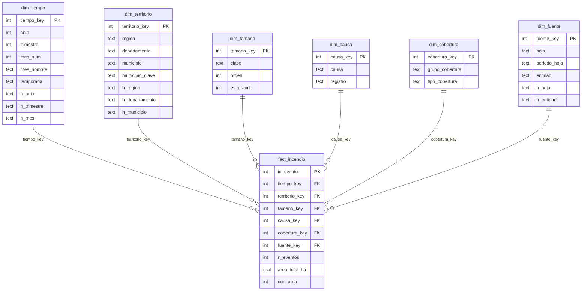

# Modelo estrella de incendios de la cobertura vegetal

Modelo multidimensional del mismo conjunto de datos de la Etapa 2: la Base de Datos de Incendios
de la Cobertura Vegetal (BD-ICV) del IDEAM, 2010-2024, ya tratada (35.355 eventos).
Se almacena en SQLite (`data/warehouse/incendios_dw.db`) y se crea con `sql/schema.sql`.
El procedimiento de carga está en `scripts/etl/build_dw.py` y su correspondencia con las
variables originales en [etl_mapeo.md](etl_mapeo.md).

## 1. Diagrama

Tamaño del modelo cargado:

| Tabla | Filas |
|---|---|
| `fact_incendio` | 35.355 |
| `dim_tiempo` | 196 |
| `dim_territorio` | 1.058 |
| `dim_tamano` | 5 |
| `dim_causa` | 8 |
| `dim_cobertura` | 13 |
| `dim_fuente` | 23 |

## 2. Granularidad y unidad de análisis

- **Unidad de análisis:** el evento de incendio de cobertura vegetal reportado. Es lo que se estudia.
- **Granularidad de la tabla de hechos:** una fila por evento reportado (`id_evento`, de 1 a 35.355,
  en el orden del CSV tratado). Es el mismo índice `ID_EVENTO` que se usó en Power BI.

Coinciden en tamaño, pero son conceptos distintos: la unidad de análisis es lo que se estudia y
la granularidad es una decisión de diseño sobre qué representa una fila de hechos. Se elige el
evento para que **ninguna dimensión multiplique filas**: cada evento se relaciona con un solo
miembro de cada dimensión, así que un JOIN con las seis dimensiones devuelve exactamente 35.355
filas y ninguna suma se duplica.

### Atributos con varios valores

Un evento puede tener varias causas o varias coberturas. Si se modelaran como filas adicionales
en la tabla de hechos, se multiplicarían los eventos y las hectáreas. Para evitarlo:

- **Causa:** si el evento tiene una sola causa, esa causa; si tiene dos o más distintas, el
  miembro "Mas de una causa" (49 eventos); si no tiene ninguna, "Sin causa registrada".
- **Cobertura:** si tiene un solo tipo, ese tipo; si tiene dos o más, "Mas de un tipo de
  cobertura" (1.285 eventos); si no tiene ninguno, "Sin cobertura informada".

## 3. Diccionario de datos

### fact_incendio (tabla de hechos)

| Columna | Tipo | Descripción | Clave |
|---|---|---|---|
| `id_evento` | INTEGER | Identificador del evento: posición (1 a 35.355) en el CSV tratado | PK |
| `tiempo_key` | INTEGER | Mes y año del evento | FK → `dim_tiempo` |
| `territorio_key` | INTEGER | Departamento y municipio del evento | FK → `dim_territorio` |
| `tamano_key` | INTEGER | Clase de tamaño según las hectáreas | FK → `dim_tamano` |
| `causa_key` | INTEGER | Causa registrada | FK → `dim_causa` |
| `cobertura_key` | INTEGER | Tipo de cobertura vegetal afectada | FK → `dim_cobertura` |
| `fuente_key` | INTEGER | Hoja de origen y entidad que reporta | FK → `dim_fuente` |
| `n_eventos` | INTEGER | Medida: conteo de eventos; vale 1 en cada fila | |
| `area_total_ha` | REAL | Medida: hectáreas afectadas; `NULL` si no hay dato (no se convierte a 0) | |
| `con_area` | INTEGER | 1 si `area_total_ha` tiene dato, 0 si es `NULL`; sirve de denominador | |

Cada columna `*_key` de la tabla de hechos tiene un índice.

### dim_tiempo

| Columna | Tipo | Descripción | Clave |
|---|---|---|---|
| `tiempo_key` | INTEGER | AAAAMM (por ejemplo 202401); AAAA00 = año sin mes válido; 0 = sin fecha | PK |
| `anio` | INTEGER | Año; `NULL` si no hay fecha | |
| `trimestre` | INTEGER | 1 a 4; `NULL` si el mes se desconoce | |
| `mes_num` | INTEGER | 1 a 12; `NULL` si se desconoce | |
| `mes_nombre` | TEXT | "Enero" a "Diciembre", "Sin mes" o "Sin fecha" | |
| `temporada` | TEXT | "1. Ene-Mar", "2. Jul-Sep", "3. Abr-Jun y Oct-Dic" o "Sin dato" | |
| `h_anio` | TEXT | Nivel 1 de la jerarquía: "2024" o "Sin fecha" | |
| `h_trimestre` | TEXT | Nivel 2: "2024-T1", "2014-sin trimestre" o "Sin fecha" | |
| `h_mes` | TEXT | Nivel 3: "2024-01", "2014-sin mes" o "Sin fecha" | |

Filas: 196 = 15 años × 12 meses (180) + 15 miembros "año sin mes" + 1 miembro "sin fecha".
La temporada coincide con el trimestre (T1 = enero-marzo; T3 = julio-septiembre; T2 y T4 =
el resto), por eso el trimestre es la forma natural de profundizar el hallazgo de la Etapa 4.

### dim_territorio

| Columna | Tipo | Descripción | Clave |
|---|---|---|---|
| `territorio_key` | INTEGER | Clave subrogada; 0 = territorio totalmente desconocido | PK |
| `region` | TEXT | Región natural; "Sin region" si no hay departamento | |
| `departamento` | TEXT | Departamento; "Sin departamento" | |
| `municipio` | TEXT | Nombre para mostrar (la variante más frecuente); "Sin municipio" | |
| `municipio_clave` | TEXT | Nombre normalizado: mayúsculas, sin tildes, sin espacios sobrantes | |
| `h_region` | TEXT | Nivel 1 de la jerarquía (igual a `region`) | |
| `h_departamento` | TEXT | Nivel 2 (igual a `departamento`; es único entre regiones) | |
| `h_municipio` | TEXT | Nivel 3: `departamento / municipio`, que distingue municipios homónimos | |

Clave natural: `UNIQUE (departamento, municipio_clave)`. La clave del territorio es el **par**
departamento-municipio, nunca el municipio solo, porque hay municipios con el mismo nombre en
distintos departamentos.

### dim_tamano

| Columna | Tipo | Descripción | Clave |
|---|---|---|---|
| `tamano_key` | INTEGER | 0 = Sin dato, 1, 2, 3, 4 | PK |
| `clase` | TEXT | "Sin dato", "<= 1 ha", "1-10 ha", "10-100 ha" o "> 100 ha" | |
| `orden` | INTEGER | Orden de presentación | |
| `es_grande` | INTEGER | 1 solo para "> 100 ha" | |

Reglas: área `NULL` → 0; hasta 1 ha → 1; más de 1 y hasta 10 → 2; más de 10 y hasta 100 → 3;
más de 100 → 4.

### dim_causa

| Columna | Tipo | Descripción | Clave |
|---|---|---|---|
| `causa_key` | INTEGER | 0 sin causa; 1 Intencional; 2 Quema fuera de control; 3 Descuido o negligencia; 4 Accidental; 5 Reactivacion de focos; 6 Otra; 7 Mas de una causa | PK |
| `causa` | TEXT | Nombre de la causa (nivel 2) | |
| `registro` | TEXT | "Con causa registrada", "Mas de una causa" o "Sin causa registrada" (nivel 1) | |

### dim_cobertura

| Columna | Tipo | Descripción | Clave |
|---|---|---|---|
| `cobertura_key` | INTEGER | 0 sin cobertura informada; 1 a 11 tipos; 12 más de un tipo | PK |
| `grupo_cobertura` | TEXT | Nivel 1 de la jerarquía | |
| `tipo_cobertura` | TEXT | Nivel 2 | |

| Grupo | Tipos |
|---|---|
| Bosques | Bosque natural denso, Bosque intervenido, Bosque plantado, Bosque seco |
| Pastos y sabanas | Sabanas y pastizales, Pastos manejados |
| Cultivos | Cultivos |
| Paramos | Paramos |
| Vegetacion arbustiva y seca | Rastrojo, Vegetacion seca |
| Sin determinar | Cobertura sin determinar |
| Varios tipos | Mas de un tipo de cobertura |
| No informada | Sin cobertura informada |

### dim_fuente

| Columna | Tipo | Descripción | Clave |
|---|---|---|---|
| `fuente_key` | INTEGER | Clave subrogada | PK |
| `hoja` | TEXT | Hoja del libro de origen: `BD_ICV_2010_2020`, `BD_ICV_2021`, ..., `BD_ICV_2024` | |
| `periodo_hoja` | TEXT | "2010-2020", "2021", ..., "2024" | |
| `entidad` | TEXT | Entidad que reporta; "No aplica (hoja sin ese campo)" o "Sin dato" | |
| `h_hoja` | TEXT | Nivel 1 de la jerarquía (la hoja) | |
| `h_entidad` | TEXT | Nivel 2: `hoja / entidad` | |

Clave natural: `UNIQUE (hoja, entidad)`. El campo `ENTIDAD_REPORTA` solo existe en la hoja
2024; en las hojas anteriores el miembro es "No aplica (hoja sin ese campo)", que es distinto
de "Sin dato" (hoja 2024 con la entidad vacía).

## 4. Jerarquías

Cada nivel agrupa de forma válida al siguiente (cada hijo pertenece a un solo padre).

| Dimensión | Jerarquía | Observación |
|---|---|---|
| Tiempo | `h_anio` → `h_trimestre` → `h_mes` | Principal |
| Territorio | `h_region` → `h_departamento` → `h_municipio` | Principal; el municipio incluye el departamento para no confundir homónimos |
| Cobertura | `grupo_cobertura` → `tipo_cobertura` | Los grupos son una agrupación propia del equipo |
| Causa | `registro` → `causa` | |
| Fuente | `h_hoja` → `h_entidad` | |

Además, `tiempo.temporada` y `tamano.clase` son niveles de un solo escalón.

## 5. Medidas

Se calculan con SQL sobre la tabla de hechos. "Aditiva" significa que se puede sumar entre
grupos; las razones y proporciones **no** se suman: se recalculan en cada nivel.

| Medida | Expresión SQL | Unidad | Aditiva | Significado y cuándo suma |
|---|---|---|---|---|
| `eventos` | `SUM(f.n_eventos)` | eventos | Sí | Número de eventos reportados. Suma entre cualquier grupo. |
| `eventos_con_area` | `SUM(f.con_area)` | eventos | Sí | Eventos con área informada. Es el denominador de los indicadores de tamaño. |
| `hectareas` | `SUM(f.area_total_ha)` | ha | Sí | Hectáreas afectadas; ignora los `NULL`. Suma entre grupos. |
| `ha_por_evento` | `SUM(f.area_total_ha) * 1.0 / NULLIF(SUM(f.con_area), 0)` | ha/evento | No | Promedio de hectáreas por evento con área. Es una razón: no se suma ni se promedia entre grupos. |
| `pct_grandes` | `100.0 * SUM(CASE WHEN f.tamano_key = 4 THEN f.n_eventos ELSE 0 END) / NULLIF(SUM(f.con_area), 0)` | % | No | Porcentaje de eventos de más de 100 ha. Denominador: eventos con área del grupo. |
| `pct_total` | `100.0 * SUM(f.n_eventos) / SUM(SUM(f.n_eventos)) OVER ()` | % | No | Participación sobre el total de la consulta (no sobre el total del modelo). |

No hay mediana: SQLite no la trae; el promedio por evento debe leerse junto con la asimetría de
la distribución (mediana de 2 ha y promedio de 46,6 ha en todo el conjunto).

## 6. Reglas de diseño

- **Una fila, un evento.** Ninguna relación multiplica filas ni hectáreas.
- **Contar no es sumar.** `eventos` cuenta registros; `hectareas` suma cantidades; no hay
  conteo de entidades únicas distintas del evento porque el evento es la unidad.
- **Faltantes, desconocidos y negativos son cosas distintas.** El área ausente queda `NULL` (no
  se convierte en 0 y no entra en promedios); la causa `0` es una respuesta negativa y "Sin
  definir" no es informativa, y ambas pasan a "Sin causa registrada"; el territorio y el
  tiempo desconocidos tienen miembros explícitos ("Sin departamento", "Sin municipio",
  "Sin fecha", "Sin mes").
- **Los porcentajes y promedios se recalculan al cambiar de nivel**; nunca se suman los de
  grupos. Cada indicador muestra su denominador.
- **Asociación no es causalidad.** Las explicaciones que los datos no permiten comprobar se
  presentan como hipótesis.

## 7. Supuestos

1. **Regiones naturales.** Cada departamento se asigna a una sola región; es una simplificación.
   Referencia: regiones naturales de Colombia (IGAC). Los departamentos sin dato van a
   "Sin region".

   | Región | Departamentos |
   |---|---|
   | Amazonia | Amazonas, Caquetá, Guainía, Guaviare, Putumayo, Vaupés |
   | Orinoquia | Arauca, Casanare, Meta, Vichada |
   | Caribe | Atlántico, Bolívar, Cesar, Córdoba, La Guajira, Magdalena, Sucre |
   | Pacifica | Chocó, Valle del Cauca, Cauca, Nariño |
   | Insular | San Andrés, Providencia y Santa Catalina |
   | Andina | Antioquia, Boyacá, Caldas, Cundinamarca, Huila, Norte de Santander, Quindío, Risaralda, Santander, Tolima, Bogotá D.C. |

2. **Grupos de cobertura.** La agrupación de los 11 tipos en grupos es una decisión del equipo,
   no una clasificación oficial.
3. **Incendio grande.** Se define como el de más de 100 ha.
4. **Cobertura y hectáreas.** Las hectáreas por cobertura del modelo son el área **total** del
   evento asignada a su cobertura; no son las hectáreas por columna `COB_*` de la Etapa 4
   (669.358 ha). Las dos cifras no son comparables (véase [validaciones.md](validaciones.md)).
5. **Cobertura y causa solo existen en parte del periodo.** La cobertura no existe en las
   hojas 2021-2024 y la causa no existe en las hojas 2023-2024; los eventos de esas hojas caen
   en "Sin cobertura informada" y "Sin causa registrada". Eso no significa que no tuvieran causa
   ni cobertura, sino que no se registraron.
6. **Nombres de miembros sin tildes** (por ejemplo "Pacifica", "Paramos"), para que todas las
   vistas usen las mismas cadenas en filtros y consultas. Los departamentos conservan la
   escritura del CSV.
